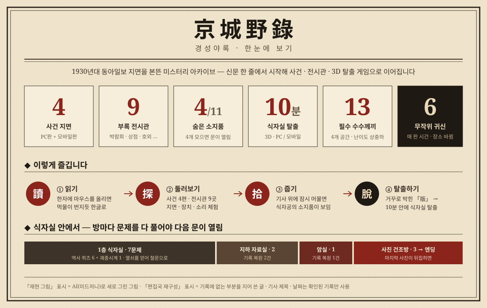
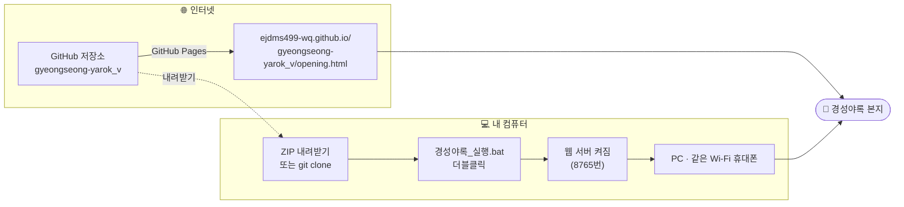
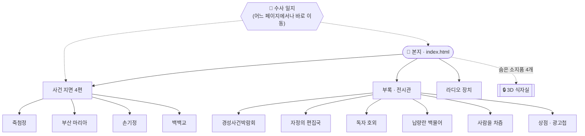
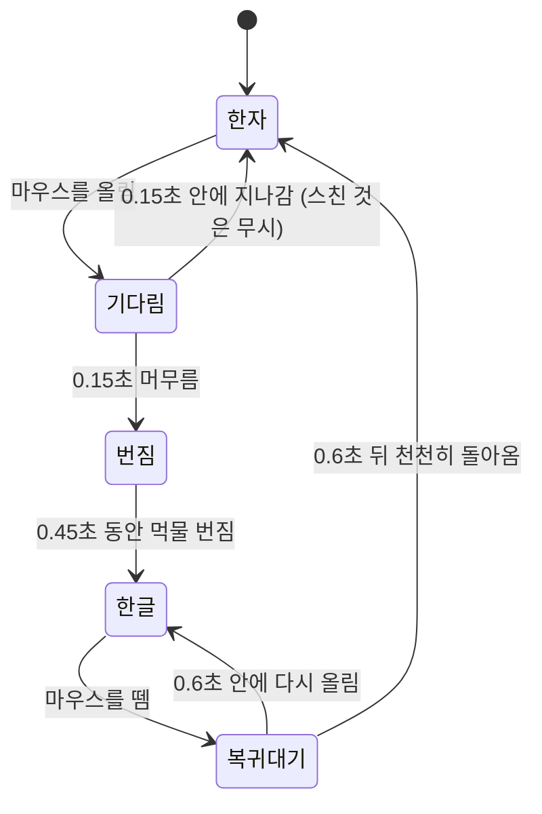
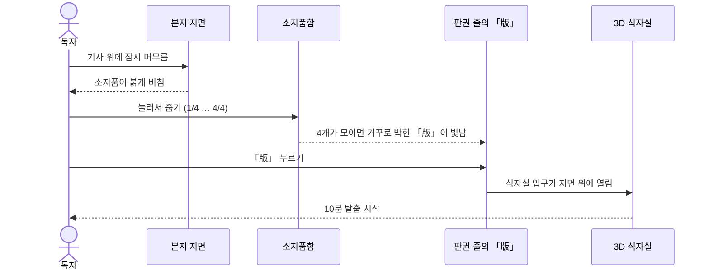
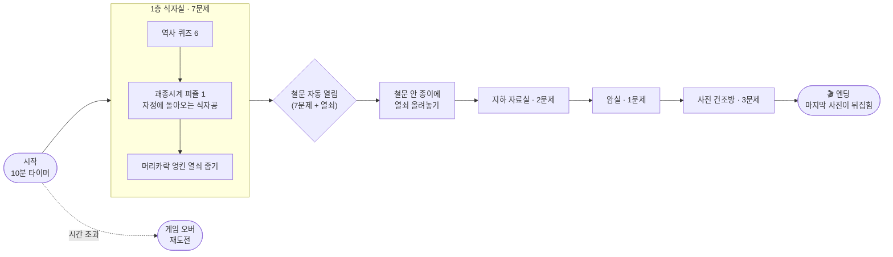
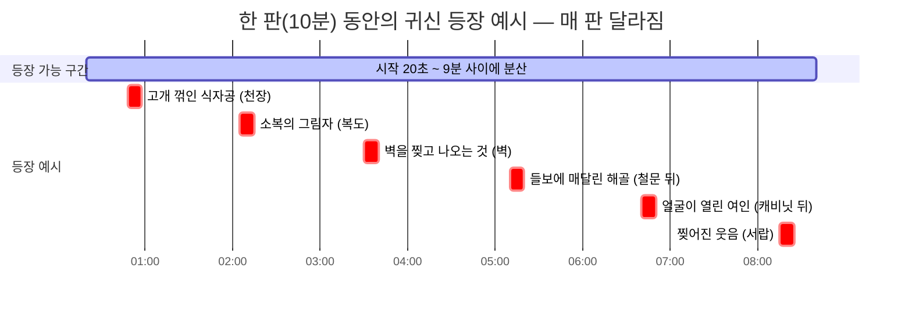
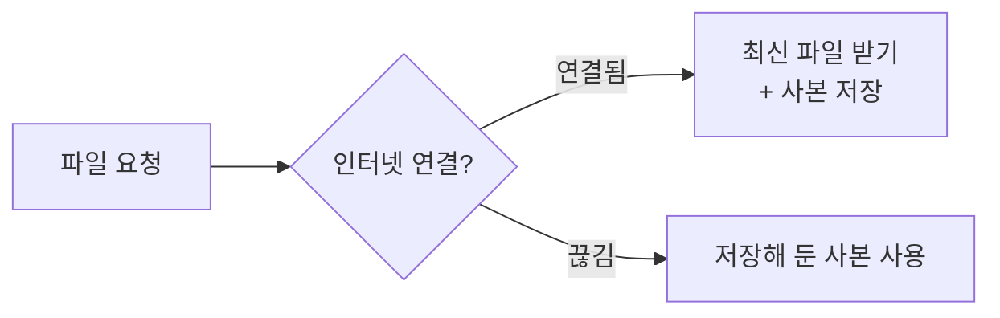
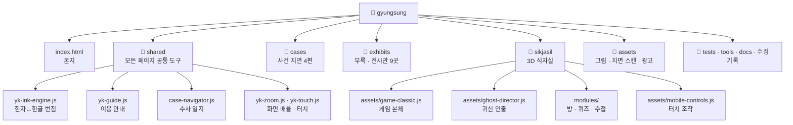

# 경성야록 京城野錄

> 밤이 깊어지면 잊힌 사건이 깨어나리라 — 신문 한 줄에서 시작되는 경성의 기이한 이야기

1930년대 동아일보 지면을 본뜬 **미스터리 아카이브 웹사이트**입니다.
실제 신문 기사 한 줄에서 출발해, 그날의 사건을 지면 · 장치 · 소리로 다시 펼쳐 보이고,
지면에 숨은 단서를 모으면 **3D 탈출 게임 「식자실」**의 문이 열립니다.



---

## 목차

1. [바로 시작하기](#1-바로-시작하기)
2. [사이트 지도](#2-사이트-지도)
3. [읽는 법 — 한자가 한글로](#3-읽는-법--한자가-한글로)
4. [숨은 소지품과 식자실의 문](#4-숨은-소지품과-식자실의-문)
5. [3D 식자실 게임](#5-3d-식자실-게임)
6. [무작위 귀신 연출](#6-무작위-귀신-연출)
7. [휴대폰 앱처럼 쓰기 (PWA)](#7-휴대폰-앱처럼-쓰기-pwa)
8. [폴더 구조](#8-폴더-구조)
9. [고치고 확인하는 법 (개발자용)](#9-고치고-확인하는-법-개발자용)
10. [알려 두는 것](#10-알려-두는-것)

---

## 1. 바로 시작하기

### 🌐 인터넷으로 보기 (설치 없음)

| | 주소 |
|---|---|
| **사이트 바로 열기** | **https://ejdms499-wq.github.io/gyeongseong-yarok_v/opening.html** |
| 3D 식자실 바로가기 | https://ejdms499-wq.github.io/gyeongseong-yarok_v/sikjasil/ |
| 소스 코드 (GitHub 저장소) | https://github.com/ejdms499-wq/gyeongseong-yarok_v |

- PC · 휴대폰 어디서나 주소만 열면 됩니다. 소리를 켜고 보시는 것을 권합니다.
- 휴대폰에서 식자실을 홈 화면에 추가하면 앱처럼 쓸 수 있습니다. → [7. 휴대폰 앱처럼 쓰기](#7-휴대폰-앱처럼-쓰기-pwa)

### 💻 내 컴퓨터에서 실행하기

1. 저장소 페이지에서 **Code → Download ZIP**으로 내려받아 압축을 풉니다.
   (git을 쓴다면 `git clone https://github.com/ejdms499-wq/gyeongseong-yarok_v.git`)
2. 폴더 안의 **`경성야록_실행.bat`**을 더블클릭합니다. (맥은 `경성야록_열기.command`)
   - 컴퓨터에 [Python](https://www.python.org/downloads/)이 설치돼 있어야 합니다.
3. 브라우저가 저절로 열립니다. 창에 나오는 주소로 같은 Wi-Fi의 휴대폰에서도 접속할 수 있습니다.

```text
[1] 스마트폰 / 태블릿 : http://192.168.x.x:8765/          ← 같은 Wi-Fi에서 휴대폰으로 접속
[2] PC 브라우저       : http://localhost:8765/
    3D 식자실 바로가기 : http://192.168.x.x:8765/sikjasil/
```

> 창을 닫거나 `Ctrl + C`를 누르면 서버가 꺼집니다.
> `index.html`을 더블클릭해서 바로 열 수도 있지만, 이때는 일부 소리 · 게임 기능이 제한됩니다.



---

## 2. 사이트 지도

| 칸 | 위치 | 내용 |
|---|---|---|
| **본지 (첫 화면)** | `index.html` | 사건 기사 · 부록 · 편집국 · 독자 호외 · 광고칸 |
| **사건 지면 4편** | `cases/jukcheomjeong/` · `cases/maria/` · `cases/sonkijeong/` · `cases/baekbaekgyo/` | 죽첨정 골목의 어린 주검 · 부산 마리아 참살사건 · 손기정, 지워진 가슴 · 백백교, 희게 더 희게<br/>각 폴더의 `index.html`은 PC판, `m.html`은 모바일판 |
| 경성사건박람회 | `exhibits/fair/` · `exhibits/expo/` · `exhibits/appendix/` | 자정에 열리는 부록 박람회 |
| 자정의 편집국 | `exhibits/newsroom/` | 암호로 잠긴 기자 전용 방 |
| 독자 호외 | `exhibits/hogoe/` | 내 이야기를 호외로 찍는 인쇄소 |
| 납량란 | `exhibits/napryang/` | 자정의 백물어 |
| 사람을 차즘 | `exhibits/seek/` | 사람을 찾는 심인 광고면 |
| 상점 · 광고첩 | `exhibits/shop/` · `exhibits/adcollection/` | 그 시절 신문 광고 진열장 |
| 라디오 장치 | `radio-device/` | 라디오 경성 |
| **3D 식자실** | `sikjasil/` | 1934년 경성 활판 인쇄소 탈출 게임 |



---

## 3. 읽는 법 — 한자가 한글로

지면의 국한문(한자 섞인 옛 글)에 마우스를 올리면, **먹물이 번지듯** 오늘 말(한글)로 바뀝니다.
휴대폰에서는 글자를 **한 번 누르면** 바뀌고, 다시 누르면 돌아옵니다.
상단의 **[漢 국한문 ↔ 가 오늘말]** 단추를 누르면 지면 전체가 한 번에 바뀝니다.



- 한자와 한글을 **같은 자리에 겹쳐 두고** 투명도만 바꾸기 때문에, 글자가 바뀌어도 줄이 밀리거나 화면이 흔들리지 않습니다.
- 시간 값은 `shared/yk-ink-engine.js` 맨 위의 `HOVER_DELAY`, `DISSOLVE_MS`, `LEAVE_DELAY`에서 바꿀 수 있습니다.
- 운영체제에서 '동작 줄이기'를 켠 사람에게는 번짐 없이 바로 바뀝니다.

---

## 4. 숨은 소지품과 식자실의 문

본지 기사 위에 마우스를 **잠시(약 0.5초) 머무르면**, 사라진 식자공이 떨어뜨린 소지품이 붉게 비쳐 나타납니다.
모두 11개가 숨어 있고, 그중 **4개를 주우면** 식자실의 문이 열립니다.
휴대폰에서는 소지품이 처음부터 보이며, 눌러서 줍습니다.



| 소지품 예시 | 숨은 곳 |
|---|---|
| 이름표 달린 회중시계 · 녹슨 가위 · 펜촉 부러진 만년필 · 긁힌 문 사진 | 사건 기사 4칸 |
| 붉은 실 감긴 열쇠 · 긁힌 활자 덩어리 | 목차 · 맨 아래 칸 |
| 깨진 손거울 · 인형 머리 | 부록 · 응접실 |
| 타 버린 성냥갑 · 살덩이 같은 덩어리 · 검붉은 약병 | 광고칸 |

> 모은 소지품은 화면을 보는 동안만 기억합니다. 새로고침하면 처음부터 다시 모아야 합니다.
> 우측 상단 **📂 수사 일지**의 식자실 카드는 소지품을 다 모으기 전까지 잠겨 있습니다.

---

## 5. 3D 식자실 게임

1934년 10월 24일 깊은 밤, 경성의 한 신문사 인쇄소 식자실.
식자공이 흔적도 없이 사라졌습니다. **10분 안에** 방마다 기록을 복원하고 빠져나가야 합니다.



| | PC | 휴대폰 (가로 화면 권장) |
|---|---|---|
| 이동 | `W` `A` `S` `D` | 왼쪽 아래 원형 조이스틱 (기울기만큼 빠르게) |
| 둘러보기 | 마우스 | 화면을 손가락으로 밀기 |
| 조사하기 | `E` 또는 마우스 왼쪽 클릭 | 오른쪽 아래 조사 버튼 |
| 수첩 | `Tab` / `N` | 수첩 버튼 |
| 손전등 | `F` | 손전등 버튼 |

- 모든 문제는 게임 안 단서와 **3단계 힌트**로 풀 수 있고, 틀려도 다시 시도할 수 있습니다. 난이도는 **상 · 중 · 하**로 표시합니다.
- 맞히면 짧은 해설과 다음 할 일을 알려 주고, 정답음(`correct.mp3`)이 납니다. 마지막 사진이 뒤집힐 때 엔딩음(`ending.mp3`)이 한 번 울립니다.
- 초록색 공간 힌트는 평소 희미하다가 가까이 겨냥하면 진해집니다. 자세한 위치는 [게임 · 힌트 위치 목록](docs/game-and-hint-locations.ko.md)을 보세요.
- 철문 안 방에서는 벽과 천장에 손 그림자 24개가 움직이고, 그 방 안에서만 낮은 크리처 소리가 납니다.
- 괘종시계 퍼즐은 창작 공포 장치이며, 역사적 사건의 기록이 아닙니다.
- 새로고침하면 진행이 처음으로 돌아갑니다.

---

## 6. 무작위 귀신 연출

탐색 중 귀신 **6종이 한 번씩, 모두 6번** 나타납니다. 매 판마다 등장 시간 · 순서 · 장소가 새로 정해집니다.



| 귀신 | 파일 (`sikjasil/assets/ghosts/`) |
|---|---|
| 고개 꺾인 식자공 | `crawler.png` · `crawler_anim.png` |
| 소복의 그림자 | `shroud.png` · `shroud_anim.png` |
| 벽을 찢고 나오는 것 | `wall.png` · `wall_anim.png` |
| 들보에 매달린 해골 | `hanged.png` · `hanged_anim.png` |
| 얼굴이 열린 여인 | `cabinet.png` · `cabinet_anim.png` |
| 찢어진 웃음 | `ink.png` · `ink_anim.png` |

- 장소 후보는 천장 · 바닥 · 코너 · 캐비닛 뒤 · 벽 · 복도 · 서랍 · 철문 뒤 8곳이며, 그중 6곳을 겹치지 않게 고릅니다. 등장 사이에는 최소 20초 간격을 둡니다.
- 귀신 한 번은 약 2.4초입니다. 그동안 `*_anim.png`(4칸 × 2줄 = 8장)를 2초에 걸쳐 넘기며 움직입니다.
- 소리는 괴물 음원 3종 중 하나를 무작위로 재생합니다. 기본 음량은 18%이고, 전체 음량 · 음소거 설정을 따릅니다.
- 조사창 · 수첩을 읽는 동안에는 귀신 팝업을 숨깁니다. 귀신 화면은 터치 · 클릭을 가로채지 않습니다. 게임이 끝나면 남은 등장 예약은 취소됩니다.
- 파일을 더블클릭해서 여는 경우(`file://`)에는 `media-local-ghosts.js`가 같은 그림을 대신 제공합니다.
- 귀신 움직임 미리보기: `tools/ghost-preview.html`

---

## 7. 휴대폰 앱처럼 쓰기 (PWA)

GitHub Pages(HTTPS)에서 `/sikjasil/`을 열면 홈 화면에 앱처럼 설치할 수 있습니다. 별도 서버 · 앱스토어 · APK가 필요 없습니다.

- **Android Chrome**: 게임의 '플레이 안내' → '홈 화면에 앱 설치', 또는 Chrome 메뉴 → 앱 설치
- **iPhone Safari**: 공유 → 홈 화면에 추가
- 처음 실행할 때는 인터넷에 연결하세요. 업데이트를 받으려면 앱을 완전히 닫고 인터넷에 연결한 상태로 다시 여세요.



| 담당 파일 | 범위 |
|---|---|
| `sw.js` · `manifest.json` | 사이트 전체 |
| `game-pwa-sw.js` · `sikjasil/manifest.webmanifest` · `sikjasil/pwa-install.js` | 식자실 게임 |

> 실제 휴대폰의 설치 · 음향 · 성능은 기기에서 따로 확인해야 합니다.

---

## 8. 폴더 구조



| 폴더 / 파일 | 하는 일 |
|---|---|
| `index.html` | 본지. 지면 대부분이 이 파일 하나에 들어 있음 |
| `sikjasil-egg.js` | 숨은 소지품 · 판권 줄의 「版」 · 식자실 입구 |
| `shared/` | 공통 도구. **공통 기능은 여기서만 고칩니다** |
| `cases/<사건>/` | `index.html`(PC) · `m.html`(모바일) · 사건별 js/css |
| `exhibits/<전시관>/` | 전시관별 html · js · css |
| `sikjasil/assets/` | 게임 본체 · 귀신 · 사망 연출 · 길안내 · 터치 조작 |
| `sikjasil/modules/` | 역사 퀴즈 · 방 퍼즐 · 시선 힌트 · 수사 수첩 · 출구 연출 |
| `assets/` | 그림 · 지면 스캔 · 광고 · 초상 등 |
| `tests/` | 자동 검사 |
| `tools/` | 점검 · 미리보기 도구 (`full_audit.py`, `ghost-preview.html` 등) |
| `수정기록/` | 날짜별 작업 기록 (쉬운 말) |
| `docs/` | 게임 · 힌트 위치 목록, README 그림 |

---

## 9. 고치고 확인하는 법 (개발자용)


**지킬 것**

- 공통 기능은 `shared/`에서만 고치고, 다른 폴더로 복사해서 맞추지 않습니다.
- 경로는 상대 경로를 씁니다. GitHub Pages처럼 주소 앞에 저장소 이름이 붙어도 동작해야 합니다.
- 공통 파일을 고쳤다면 html의 `?v=날짜` 번호를 올려서, 예전 파일이 저장돼 남지 않게 합니다.
- 파일을 지울 때는 바로 지우지 않고 `_to_delete/`로 옮긴 뒤 확인합니다.

**자주 쓰는 검사**

```bash
# 단위 테스트
node --test tests/*.test.cjs

# 브라우저 검사 (서버를 켠 상태에서, Playwright 필요)
node tests/history-game-smoke.cjs
node tests/ghost-browser-smoke.cjs
node tests/ghost-visual-smoke.cjs
node tests/feedback-audio-smoke.cjs
node tests/clock-puzzle-smoke.cjs
node tests/exit-horror-smoke.cjs
node tests/game-input-smoke.cjs
node tests/ui-overlap.cjs
GAME_TEST_URL=http://127.0.0.1:8765 node tests/pwa-smoke.cjs

# 깨진 경로(404) 점검
python tools/full_audit.py
```

- 테스트 서버 주소는 `GAME_TEST_URL`, Playwright 모듈 위치는 `PLAYWRIGHT_MODULE`로 바꿀 수 있습니다.
- 모바일 에뮬레이션과 별도로, 실제 iOS Safari · Android Chrome에서 터치 · 음향 · 성능을 확인해야 합니다.

---

## 10. 알려 두는 것

- 「재현 그림」 표시가 있는 그림은 AI(미드저니)로 새로 그린 것이며 실제 사진이 아닙니다.
- 「편집국 재구성」 표시가 있는 글은 기록에 없는 부분을 편집국이 지어 쓴 것입니다. 기사 제목 · 부제 · 날짜는 확인된 기록만 썼습니다.
- 독자 호외는 이용자가 지어 내는 창작물이며 실제 사건이 아닙니다.
- 식자실의 귀신 · 괘종시계 퍼즐 등 공포 연출은 창작이며 역사적 사실이 아닙니다.
- 새로고침하거나 창을 새로 열면 진행 상황이 처음으로 돌아갑니다.


## 사용 글꼴 및 라이선스
- Yeon Sung (BM YEONSUNG Project Authors, SIL OFL 1.1) — sikjasil/assets/fonts/YeonSung-OFL.txt
